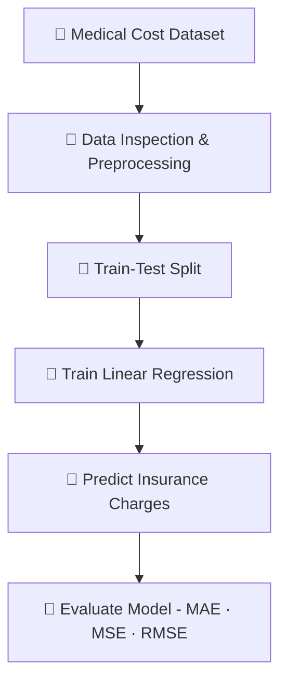

<div align="center">
    
# Medical Insurance Cost Estimator

### Predicting medical insurance charges with machine learning

**Python · Pandas · NumPy · scikit-learn · Linear Regression**

<br>


</div>

---

## 🔎 Project Overview

Can demographic and health-related information help estimate medical insurance charges?

This project explores that question by training a **linear regression model** on the Medical Cost Personal Dataset. Using Python and scikit-learn, the model learns relationships between individual characteristics and insurance charges, then generates predictions for unseen observations.

> **Project goal:** Build and evaluate a baseline regression model while practicing the core machine learning workflow—from data preparation to model evaluation.

## ✨ What This Project Covers

- 🧹 **Data preparation** — prepare numerical and categorical features for modeling.
- 📊 **Exploratory analysis** — investigate patterns in the dataset.
- 🤖 **Model training** — fit a linear regression model using scikit-learn.
- 🎯 **Prediction** — estimate individual insurance charges from input features.
- 📏 **Evaluation** — measure prediction error using MAE, MSE, and RMSE.

## 🗂️ Dataset & Features

The Medical Cost Personal Dataset contains individual-level information and medical insurance charges.

| Feature | Description |
|---|---|
| `age` | Individual's age |
| `sex` | Sex category recorded in the dataset |
| `bmi` | Body mass index |
| `children` | Number of dependents |
| `smoker` | Smoking status |
| `region` | Residential region |
| `charges` | **Target:** medical insurance charges |

The model uses the available demographic and health-related features to predict `charges`.

## ⚙️ Machine Learning Workflow



## 📈 Model Evaluation

The model was evaluated using three regression metrics.

| Metric | Result | What it tells us |
|---|---:|---|
| **MAE** | **$3,921.33** | Average absolute difference between predictions and actual charges |
| **MSE** | **31,249,003.60** | Average squared prediction error; larger errors receive greater weight |
| **RMSE** | **$5,590.08** | Typical error scale in dollars, with greater sensitivity to large errors |

### What do these results mean?

- **MAE of $3,921.33:** Predictions differed from actual charges by about $3,921 on average in absolute terms.
- **RMSE of $5,590.08:** Larger errors have a stronger effect on this metric than on MAE.
- **MSE of 31.25 million:** This is measured in squared dollars, so it is less intuitive to interpret directly.

These metrics are an initial performance snapshot, not proof that the model is good or bad on their own. A stronger assessment would compare the model against a mean-prediction baseline, calculate **R²**, and inspect actual-versus-predicted values and residuals. Evaluation results depend on the train-test split and preprocessing choices.

## 🧰 Tech Stack

| Tool | Purpose |
|---|---|
| **Python** | Core programming language |
| **Pandas** | Data manipulation and analysis |
| **NumPy** | Numerical operations |
| **scikit-learn** | Linear regression and evaluation metrics |
| **Matplotlib / Seaborn** | Visualizations, if used |
| **Jupyter Notebook** | Interactive experimentation, if used |

## 🚀 Getting Started

### 1. Clone the repository

```bash
git clone <your-repository-url>
cd medical-insurance-cost-estimator
```

### 2. Create and activate a virtual environment (recommended)

```bash
python -m venv .venv
```

macOS / Linux:

```bash
source .venv/bin/activate
```

Windows:

```bash
.venv\Scripts\activate
```

### 3. Install dependencies

Install the packages used by your project:

```bash
pip install pandas numpy scikit-learn matplotlib seaborn jupyter
```

Remove packages you do not use, or create a `requirements.txt` containing the actual project dependencies.

### 4. Run the project

Open the notebook in Jupyter, or run the Python script containing the model:

```bash
jupyter notebook
```

> Update these steps to match the actual filenames and folder structure in your repository.

## 🔭 Future Improvements

- [ ] Calculate R² and compare results with a `DummyRegressor` baseline.
- [ ] Plot actual versus predicted charges.
- [ ] Analyze residuals to identify systematic prediction errors.
- [ ] Investigate feature relationships and interactions, such as smoking status and BMI.
- [ ] Compare linear regression with models such as random forest regression.
- [ ] Use cross-validation to evaluate performance stability.

## 📁 Suggested Repository Structure

```text
medical-insurance-cost-estimator/
├── data/                 # Dataset (if included)
├── notebooks/            # Exploratory analysis and experiments
└── README.md
```

Adapt this example to reflect the files actually present in your repository.

## ⚠️ Disclaimer

This project is for educational purposes only. Predictions are estimates based on patterns in the dataset and should not be used to set real insurance premiums, make medical decisions, or determine insurance eligibility.

---

<div align="center">

**Built to practice regression modeling, data analysis, and machine learning evaluation.**

</div>
